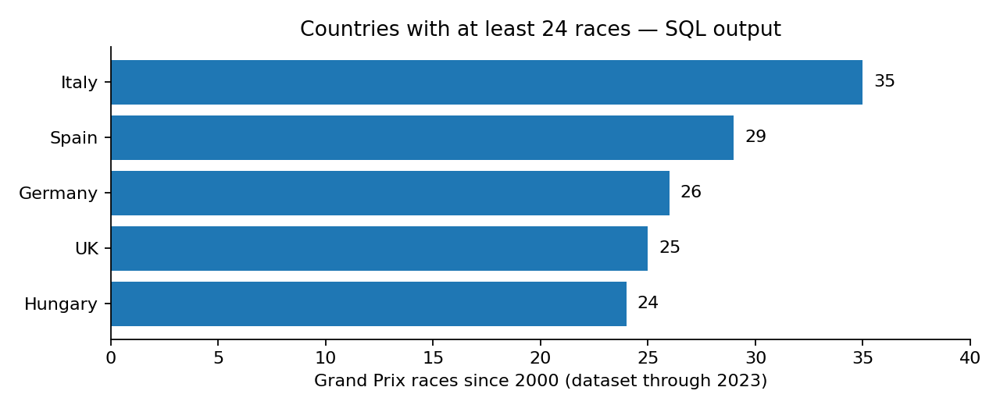
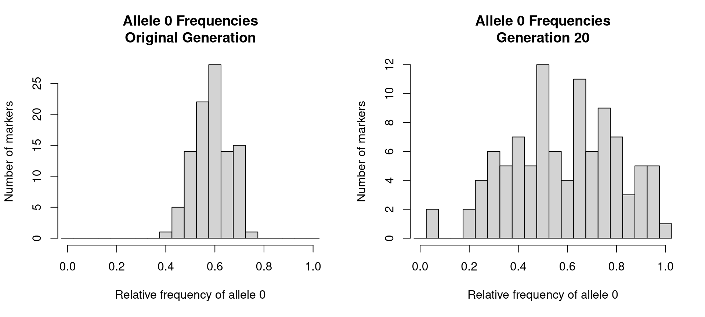
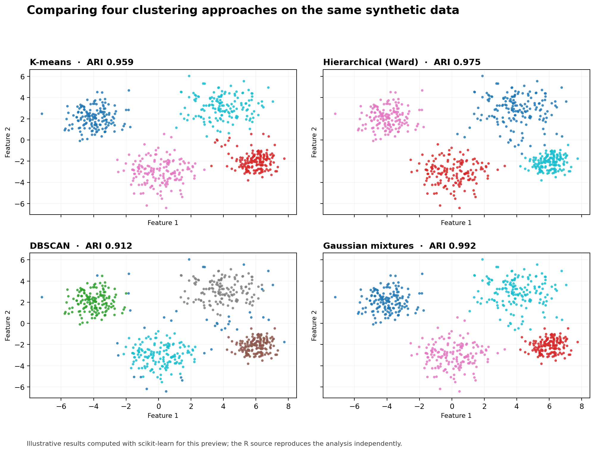

# Data Analysis & Programming

**R · SQL · Data visualisation · Probability · Clustering**

A selection of projects 
Each project has a visual result, a short explanation and the code used in the analysis.

## Projects

| Preview | Project |
|:--|:--|
|  | **[Dinosaur fossil mapping](projects/01-dinosaur-fossils/)**   Mapped fossil records after filtering invalid coordinates and compared dinosaur categories.   R · ggplot2 · data cleaning |
|  | **[Ancient Egypt isotope analysis](projects/02-ancient-egypt/)**   Cleaned archaeological records and compared strontium isotope measurements across groups.   R · dplyr · ggplot2 · Excel |
|  | **[Formula 1 database analysis](projects/03-formula1-sql/)**   Queried historical Formula 1 records to analyse circuits, locations and race counts.   SQL · SQLite · relational joins |
|  | **[Probability and simulation](projects/04-simulations/)**   Modelled genetic inheritance, daily customer arrivals and categorical mixture data.   R · Monte Carlo · custom functions |
|  | **[Clustering methods comparison](projects/05-clustering/)**   Compared four clustering algorithms on the same synthetic dataset. This is a new AI-assisted portfolio extension.   R · k-means · DBSCAN · hierarchical · Gaussian mixtures |

## Technical skills

- **R:** data frames, functions, loops, filtering, joins, grouped summaries and plotting
- **SQL / SQLite:** relational joins, filtering, aggregation, `GROUP BY`, `HAVING` and subqueries
- **Statistics:** simulation, random sampling, Monte Carlo methods and distributions
- **Clustering:** k-means, hierarchical methods, DBSCAN, Gaussian mixtures and model comparison

## Code and reproducibility

- **Original coursework:** [Assignment 1](coursework/assignment1.Rmd) · [Assignment 2](coursework/assignment2.Rmd) · [Assignment 3](coursework/assignment3.Rmd) (student ID redacted)
- **Run the code:** [Simple setup guide](HOW_TO_RUN.md)
- **Note on authorship:** Projects 1–4 contain original coursework code and results with some portfolio formatting. Project 5 is a separately developed **AI-assisted demonstration** based on course topics, not an additional assessed assignment. Original lecture demonstration scripts are not claimed as my own.

*Course datasets are not redistributed in this public repository pending a permissions check. Preview images show the supplied coursework outputs or, where identified, newly generated summaries.*
