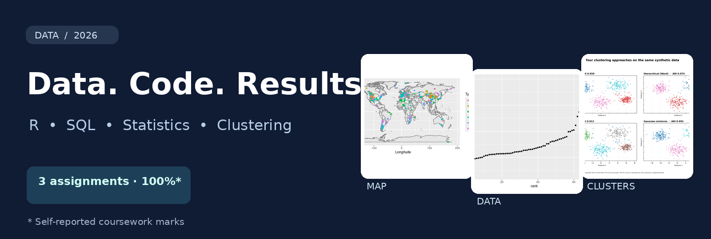

# Viraj Gandhi · Data & Programming Portfolio

**DATA202 | Victoria University of Wellington | 2026**  
**R · SQL · SQLite · R Markdown · Data visualisation · Simulation · Clustering**

A collection of data analysis projects developed from my university coursework, with the **results visible up front** and the code one click away. I received **100% in each of the three DATA202 assignments** *(as reported by me; grade records are not included in this repository)*.

### Featured projects

| Project | Preview | What I demonstrated |
|---|---|---|
| [**01 · Dinosaur fossil explorer**](projects/dinosaur-fossils/) |  | Cleaning records, spatial plots and categorical analysis in R |
| [**02 · Ancient Egypt isotope analysis**](projects/egypt-isotopes/) |  | Excel joins, `dplyr` summaries and `ggplot2` visualisations |
| [**03 · Formula 1 SQL explorer**](projects/formula1-sql/) |  | SQLite joins, queries, aggregation and historical race data |
| [**04 · Simulation models**](projects/simulation-models/) |  | Inheritance models, customer-arrival simulation and mixture models |
| [**05 · Clustering comparison lab**](projects/clustering-methods/) |  | K-means, hierarchical clustering, DBSCAN and Gaussian mixtures |

### Skills and evidence

`R programming` · `functions and loops` · `data cleaning` · `data joins` · `SQL JOIN / GROUP BY / HAVING` · `DBI / RSQLite` · `ggplot2` · `descriptive statistics` · `Monte Carlo simulation` · `unsupervised learning`

**My original graded work:** [Assignment 1](source/assignment1.Rmd) · [Assignment 2](source/assignment2.Rmd) · [Assignment 3](source/assignment3.Rmd)  
**How to run the projects:** [Quick setup guide](HOW_TO_RUN.md)  
**Visual website:** [Open portfolio website](index.html) *(works locally or with GitHub Pages)*

<strong>What is original, and what is a portfolio extension?</strong>

- Projects 01–04 showcase code and outputs from **my three DATA202 coursework submissions**. The full R Markdown files are preserved under `source/`, with private student identifiers redacted.
- Project 05 is a **new, AI-assisted portfolio extension** of clustering techniques covered in Weeks 11–12. The underlying lecture examples were course-provided; this extension is not presented as an additional graded assignment.
- SQL result values were checked using SQLite. The clustering preview was made in Python from the included synthetic data; the linked R script is a separate implementation.
- Academic marks stated above are **self-reported**. Do not infer an exam grade, course final grade or industry deployment.

