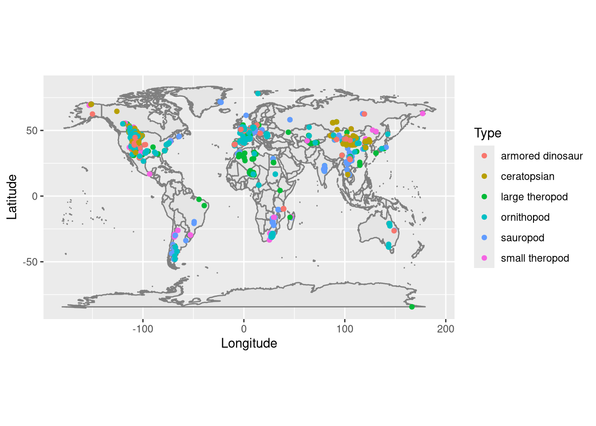
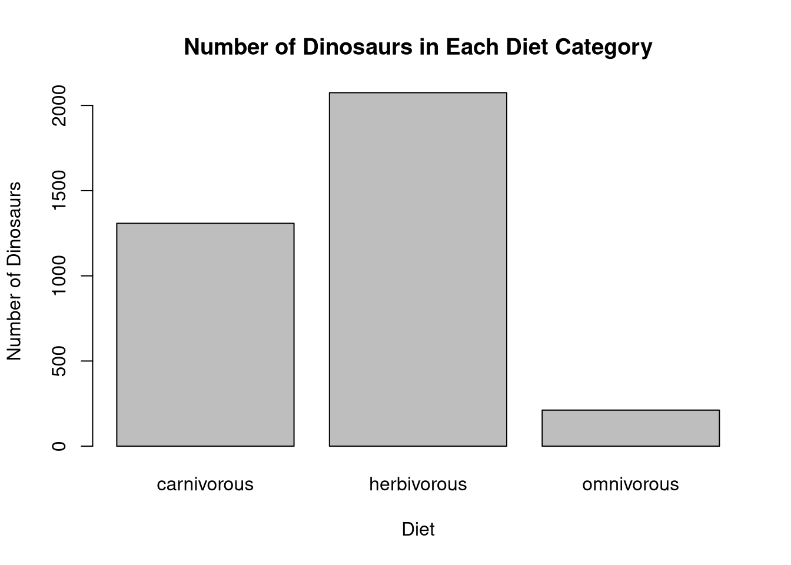

# 🦕 Dinosaur fossil explorer

[← Back to the portfolio](../../README.md) · [Browse all projects](../../index.html)

**R · ggplot2 · maps · cleaning data**

I used a dinosaur fossil dataset to **remove invalid coordinates**, keep recognised dinosaur categories and plot their locations on a world map.

I also compared the counts of dinosaur diet categories:

**What this shows:** importing CSV data, checking values, filtering records, categories/factors, and visualisation.

**Quick code:** [dinosaur_analysis.R](dinosaur_analysis.R) · **Full source:** [Assignment 1](../../source/assignment1.Rmd)

To run: copy `dinosaurs.csv` from `02_LOCAL_DATA_PRIVATE` into this folder; open it as the RStudio working directory; install `ggplot2` and `maps`; run `source("dinosaur_analysis.R", echo = TRUE)`.

*Images are from my original rendered Assignment 1. Dataset is not distributed in this repository.*
