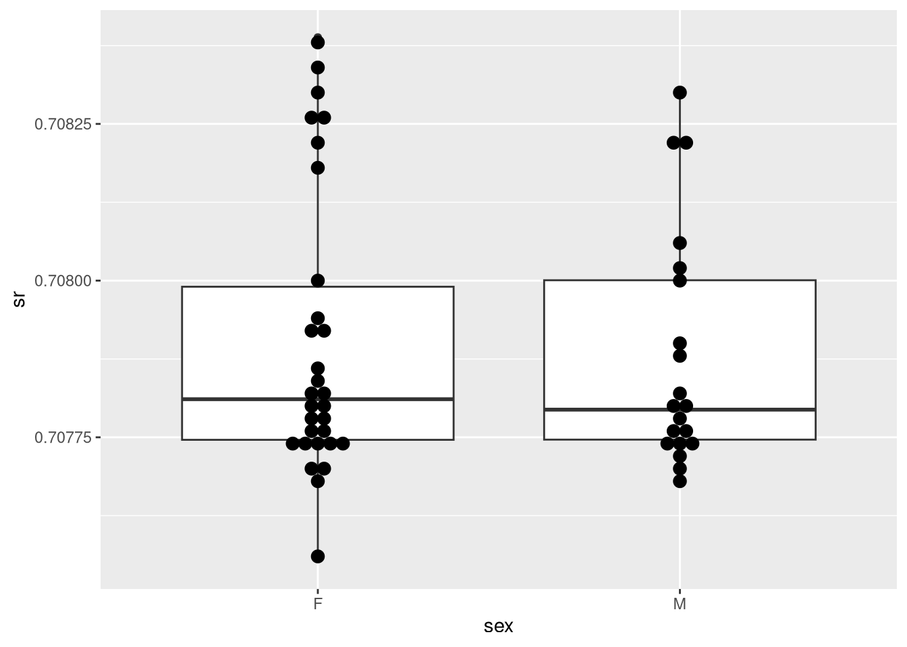
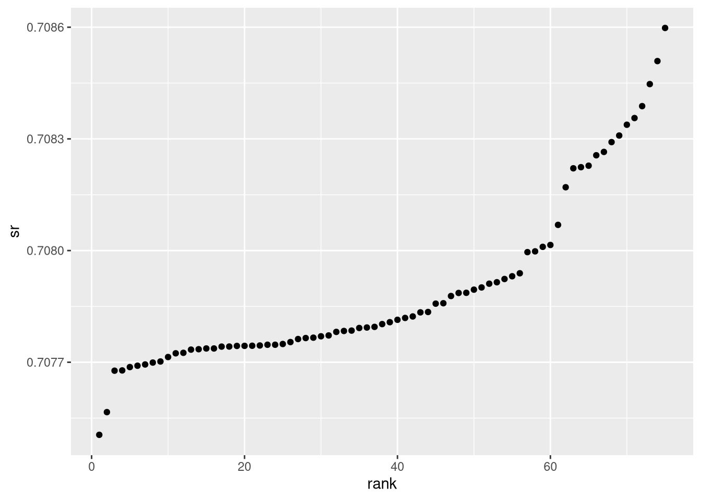

# 📊 Archaeological isotope analysis

[← Back to the portfolio](../../README.md) · [Browse all projects](../../index.html)

**R · dplyr · readxl · ggplot2**

I worked with Ancient Egyptian archaeology data, joining **two Excel worksheets**, cleaning categories, summarising measurements and comparing isotope ratios across groups.

**What this shows:** importing Excel data, matching identifiers, data cleaning, grouped summaries and plotting distributions.

**Quick code:** [isotope_analysis.R](isotope_analysis.R) · **Full source:** [Assignment 2](../../source/assignment2.Rmd)

To run: copy `EgyptData.xlsx` from `02_LOCAL_DATA_PRIVATE` into this folder; open it as the RStudio working directory; install `readxl`, `dplyr` and `ggplot2`; run `source("isotope_analysis.R", echo = TRUE)`.

*These are descriptive comparisons, not proof of a historical migration claim. Images come from the original rendered report.*

**Optional improved data-join implementation:** [reproducible_analysis.R](reproducible_analysis.R) follows the material → sample → measurement relationships explicitly. This is a portfolio refactor, separate from the original graded submission.
