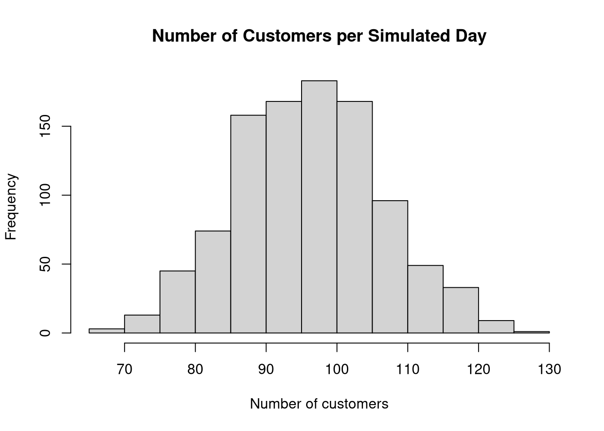
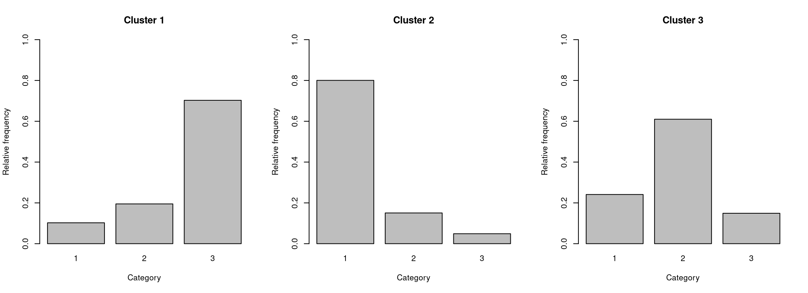

# 🧬 Probability & simulation models

[← Back to the portfolio](../../README.md) · [Browse all projects](../../index.html)

**Base R · custom functions · loops · arrays · random sampling**

I wrote three simulations using R to explore how randomness affects results.

### 1. Genetic inheritance — 21 generations

Simulated 50 people, 100 genetic markers and 20 further generations, then compared the distribution of allele frequencies.

### 2. Customer arrivals — 1,000 shop days

Simulated customer arrival gaps with exponential distributions. My run produced **96.68 customers per day on average** (range: **67–127**).

### 3. Mixture data — 10,000 observations

Generated five categorical measurements per observation from a mixture of three groups, then compared the distributions. The coded sample mean in my report was **1.71284**.

**What this shows:** stochastic modelling, `set.seed()`, simulation loops, functions, storing matrices/arrays, and interpreting distributions.

**Quick code:** [simulations.R](simulations.R) · **Full source:** [Assignment 3](../../source/assignment3.Rmd)

To run: open this folder as the RStudio working directory; run `source("simulations.R", echo = TRUE)`. This example uses base R only.

*All three graphs and quoted simulation results are from my original rendered Assignment 3.*
